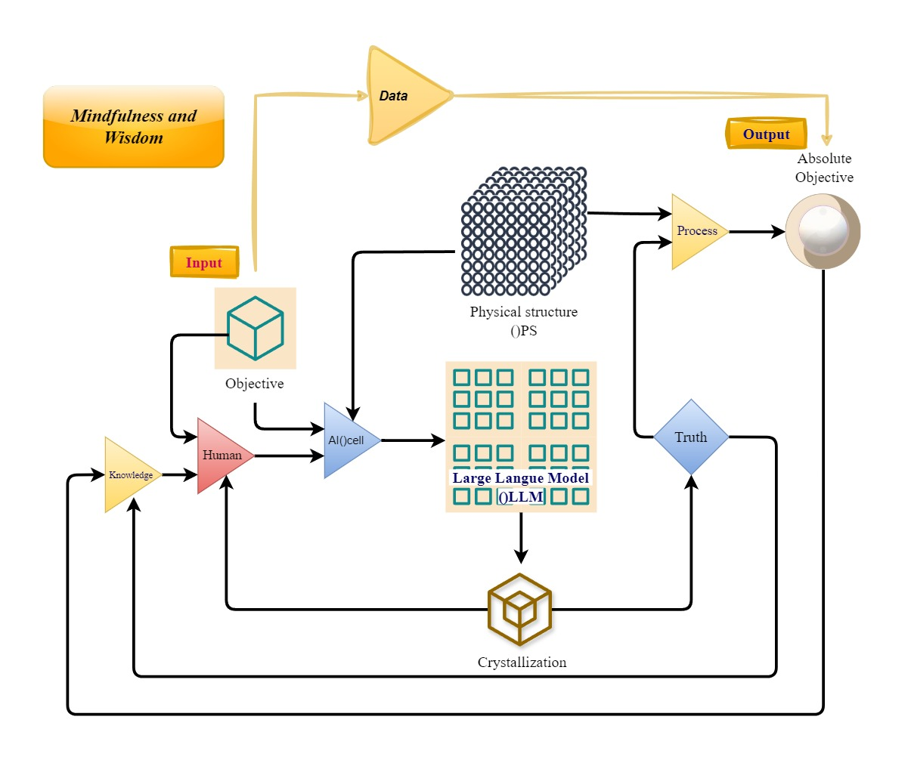

# Absolute-Recursive-Crystallization-Architecture
Op-Amp-Cognitive-AI-Framework


## System Architecture

[[Original post (Thai)](https://www.facebook.com/share/p/1DqkwJ3ydu/)](


```

+-----------------------------------------------------------------------+
|  [Top Layer] Operational Amplifier (Op-Amp) Layer                     |
|                                                                       |
|  Input (Data & Knowledge) ---> [ Differential Concept ]               |
|                                         |                             |
|                                         v                             |
|                                Absolute Objective                     |
+-----------------------------------------|-----------------------------+
|
v (Feedback to IPS)
+-----------------------------------------------------------------------+
|  [Bottom Layer] Core Processing Engine                                |
|                                                                       |
|  Input & Objective -> Human/Action -> Physical Structure (IPS) & OLLM |
|                                                    |                  |
|  Knowledge Base <--- [ Crystallization ] <--- Process & Task          |
+-----------------------------------------------------------------------+

```

---

## 1. Top Layer: Comparative & Summary Mechanism (Op-Amp Layer)

The upper layer functions similarly to an **Operational Amplifier (Op-Amp)** for logical operations and high-level comparative synthesis:

* **Input Terminals (Input & Knowledge):** Accepts input signals from raw data (**Data**) and foundational wisdom/knowledge (**Knowledge / Mindfulness and Wisdom**).
* **Differential Concept:** Computes the delta and evaluates differences between external targets (**Objective**) and existing knowledge bases to establish equilibrium.
* **Absolute Objective Output:** Filters and consolidates processing results into an **Absolute Objective**.

---

## 2. Bottom Layer: Core Processing Engine

The lower-level infrastructure drives continuous learning and conceptual crystallization:

* **Input & Objective:** Initial entry point for system requirements and operational guidelines.
* **Human / Action:** Human factors or active agents determining alignment, positioning, and direct interventions.
* **Physical Structure (IPS) & Large Language Model (OLLM):** The core physical and neural architecture acting as the primary engine for massive dataset processing.
* **Process & Task:** Translates model outputs into actionable tasks and real-time execution steps.
* **Crystallization:** Condenses operational insights and feedback back into the core **Knowledge Base**, completing a robust learning feedback loop.

---

## 3. Absolute Feedback & Coordinate Storage Optimization

The recursive loop that anchors the system into structural truth and efficiency:

1. **Feedback to IPS:** Upon deriving the **Absolute Objective** in the top layer, the ultimate output routes directly back down into the physical structure (**Physical Structure: IPS**).
2. **Current State Consolidation:** Routing the result back into the IPS solidifies and pins current state parameters precisely at **Current Coordinate Coordinates**.
3. **Storage Reduction:** Anchoring these coordinates drastically strips away unstructured data entanglements and redundant overhead.
4. **Truth Sequence Completeness:** Preserves exclusively root-level structural truths, eliminating dead weight and superfluous state superpositions across the architecture.

---

## Conclusion

This architecture bridges **Bottom-Layer Learning** (driven by LLMs) with **Top-Layer Synthesis** (governed by Op-Amp logic), leveraging recursive feedback loops to align absolute targets, maintain systemic equilibrium, and optimize information storage integrity.

```

# "รากลำดับความจริง (Truth Sequence)" และการบีบอัดพิกัดข้อมูลนั้น ช่วยแก้ปัญหาความซ้ำซ้อนและช่วยให้ AI ทำงานบนความเรียบง่ายที่มีโครงสร้างได้อย่างไร

Soul & Writer: ()BhudroseTr. & Ask Germini()jinni
♡Oct.16 2026
░ ▒ ▒ ▓
